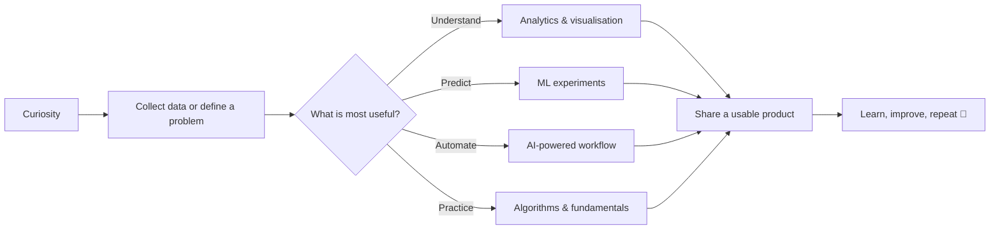

<div align="center">

# Hi, I'm Shivang 👋

### Data • AI • Backend • Product Experiments

I build practical tools that turn messy data, media, and everyday problems into useful experiences.

<a href="https://github.com/Shivang23566">
  
</a>
<a href="mailto:shivangkainth94@gmail.com">
  
</a>
<a href="https://www.linkedin.com/in/shivang-kainth">
  
</a>
<a href="https://codeforces.com/profile/S-kainth">
  
</a>


</div>

## 🧭 What I Build

| Focus | What it looks like in my work |
| --- | --- |
| 📊 **Data products** | Dataset exploration, visual analytics, and insights that are easy to understand |
| 🤖 **Applied AI** | Tools that summarize, classify, predict, and transform real-world content |
| 🧩 **Useful software** | Small applications for finance, habits, accessibility, and daily workflows |
| 🧠 **Continuous learning** | Competitive programming, internships, experiments, and new technologies |

```text
Question → Data / Media → Model or Logic → API / App → Insight or Action
```

## 🗺️ My Project Journey



<details>
<summary><b>✨ Click to see how I approach a project</b></summary>

1. **Start with the user problem** — define what should become easier, faster, or clearer.
2. **Explore the inputs** — inspect data quality, edge cases, and the simplest useful baseline.
3. **Build the smallest working path** — connect the logic to an API, dashboard, or app.
4. **Make the result understandable** — visualise the output and explain the trade-offs.
5. **Iterate in public** — learn from feedback, experiments, and better ideas.

</details>

## 🚀 Featured Projects

These are the projects that best represent the range of things I like to build:

<table>
<tr>
<td width="50%" valign="top">

### [Dataset Analyzer](https://github.com/Shivang23566/Dataset-analyzer)

An interactive Python web application for uploading a dataset, inspecting its statistics, and discovering patterns through plots.

**Python · Data analysis · Visualisation**

</td>
<td width="50%" valign="top">

### [YT Podcast Clipper](https://github.com/Shivang23566/YT_podcast_clipper)

An AI-assisted workflow for finding useful moments in long-form YouTube podcasts and turning them into shareable clips.

**Python · AI · Media automation**

</td>
</tr>
<tr>
<td width="50%" valign="top">

### [VTS Live](https://github.com/Shivang23566/VTS-live)

A voice-to-text and sign-language gesture concept focused on making communication more accessible.

**JavaScript · Speech · Accessibility**

</td>
<td width="50%" valign="top">

### [Habitu](https://github.com/Shivang23566/Habitu)

A Flutter habit tracker for daily tasks and long-term consistency.

**Dart · Flutter · Mobile**

</td>
</tr>
</table>

<details>
<summary><b>📚 Browse more repositories</b></summary>

| Repository | What it explores | Stack |
| --- | --- | --- |
| [ATM System](https://github.com/Shivang23566/ATM_system) | A functional banking/ATM software project | Python |
| [Bank Fraud Prediction](https://github.com/Shivang23566/Bank_fraud_prediction-kaggle-competition) | Fraud detection for a Kaggle competition | Jupyter Notebook |
| [NCR Ride Data Analysis](https://github.com/Shivang23566/NCR_Ride_Data_Analysis) | Analysis of ride data from the NCR region | Data analysis |
| [Internship Projects](https://github.com/Shivang23566/Internship_Projects) | A collection of work from internship projects | Jupyter Notebook |
| [Competitive Programming Solutions](https://github.com/Shivang23566/Daily_Competitive_programming_solution-s) | Daily practice and algorithmic problem solving | C++ |

</details>

## 🛠️ Tools I Enjoy

<p>
  
</p>

## 📈 GitHub at a Glance

<div align="center">
  
  
</div>

<div align="center">
  
</div>

<div align="center">
  
</div>

## 🌱 Currently Exploring

- Building more reliable data and AI workflows
- Turning experiments into polished, documented products
- Learning from open-source collaboration and real user feedback

## 🤝 Connect

If you are building something interesting with data, AI, accessibility, or developer tools, feel free to [open a conversation](mailto:shivangkainth94@gmail.com).

<p>
  <a href="https://www.linkedin.com/in/shivang-kainth">LinkedIn</a> ·
  <a href="https://codeforces.com/profile/S-kainth">Codeforces</a> ·
  <a href="https://github.com/Shivang23566">GitHub</a>
</p>

<div align="center">

**Thanks for visiting — explore a repository, try an idea, and make something useful. 🚀**

</div>
